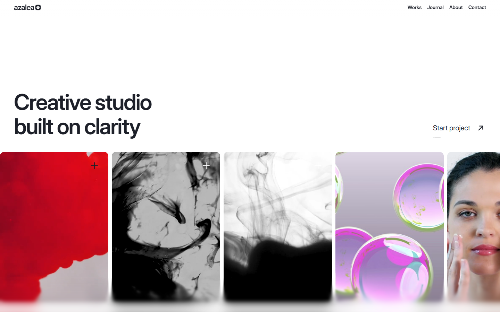

# azalea® — creative studio website



Plain static HTML/CSS/JS. No build step and no dependencies: **double-click `index.html`** to view it.
To publish, upload the whole folder as-is to any static host (Netlify, Vercel, GitHub Pages, cPanel, etc.).

## Pages (20)
```
index.html                 Home
works.html                 Works list
works/<slug>.html          6 case studies (form-weight, tideline, duo-fluxe, still-botanica, hue-pigment, ceramic-pulse)
journal.html               Journal list + newsletter form
journal/<slug>.html        6 articles (colour-rules-are-over, designing-culture-in-the-feed, redesigning-the-way-we-work,
                           the-quiet-luxury-of-soft-palettes, the-strength-of-empty-space, why-inclusive-design-lifts-everyone)
about.html                 About (process, video player, works list, team)
contact.html               Contact (form + FAQ)
privacy-policy.html, terms-of-service.html
404.html                   Not-found page
```

## Structure
```
assets/css/site.css   All styles. Design tokens in :root (colours, radius, easing).
                      Breakpoints: tablet ≤1199px, phone ≤809px; reduced-motion rules near the end.
assets/js/main.js     All interactions (vanilla JS, no libraries)
assets/img/           Photos from Unsplash (+ favicon.svg)
assets/video/         Clips from Mixkit, re-encoded without audio, each with a .jpg poster
```

## Editing content
All copy lives directly in the `.html` files — edit them in any text editor.
The header, footer, CTA block and contact details are repeated in every page, so change those with a
project-wide find & replace (e.g. VS Code “Replace in Files”) to keep all 20 pages consistent.
Pages in `works/` and `journal/` use `../assets/...` paths; root pages use `assets/...`.

## Interactions (all in `main.js`)
- Load intro: header slides down, hero fades up (0.8s, delay 0.4s, ease `cubic-bezier(.35,0,0,1)`); sections fade up on scroll.
- Header hides on scroll down, returns on scroll up; phone: “Menu/Close” full-screen menu with staggered links.
- Smooth wheel scrolling (desktop mouse only, off for reduced motion).
- Hero carousel: endless loop, arrows on hover, drag/swipe, arrow keys; “+” on a card turns into “×” and reveals a title/description overlay.
- Client logo marquees, count-up stats, scroll-growing intro image, floating object parallax, footer image parallax.
- Services: sticky stacking cards (top 70/90/110/130px).
- Testimonials slider with prev/next (prev hidden at start, next hidden at end), swipe.
- FAQ accordion; journal/works card hover (white circle + arrow, underline grows); arrow links (line grows, arrow turns →).
- Fixed progressive blur strip at the bottom of the viewport (5 backdrop-blur layers).
- About: video player with Play pill / Pause button. Articles: share on X, LinkedIn, copy link (toast).
- Forms validate and show a success state — **demo only, nothing is sent**.

## Sound
The reference site has no audio at all (all its videos are muted, no Web Audio). This build matches that: no sound.

## Placeholders to replace
- Brand name **azalea** / “Azalea Studio B.V.” (contact, privacy, terms), email `hello@azalea.studio`,
  phone `+31 20 555 01 42`, address (Amsterdam) — repeated across all pages, use find & replace.
- Client names, testimonials, team members, authors and case studies are fictional.
- “View Website” on case studies points to `https://example.com/`.
- Social links are generic (`https://www.behance.net`, instagram.com, x.com).
- Forms need a real backend or form service (e.g. Formspree, Netlify Forms) before going live.

Fonts: Inter from Google Fonts (variable, optical size 14–32 for the “Inter Display” look) — needs an internet connection.

## Credits
Photos: Unsplash (unsplash.com, Unsplash License). Videos: Mixkit (mixkit.co, Mixkit License) — IDs 41999, 44818, 152, 33201, 51185, 51187, 4742, 50426.
